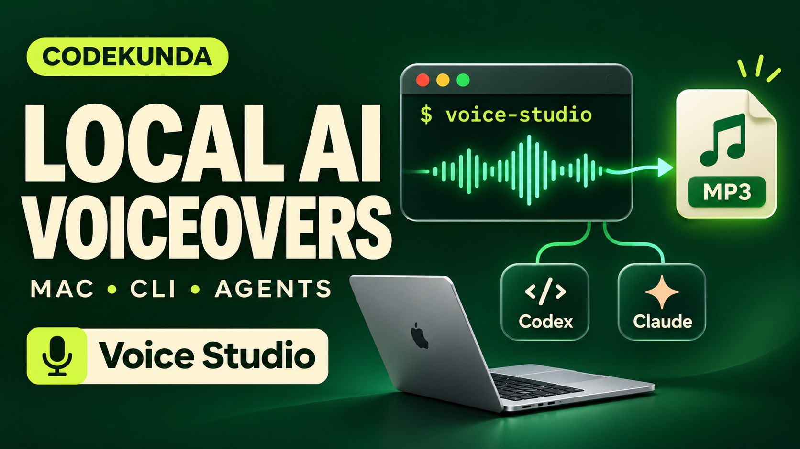
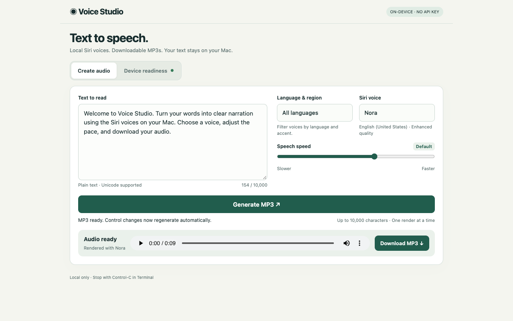
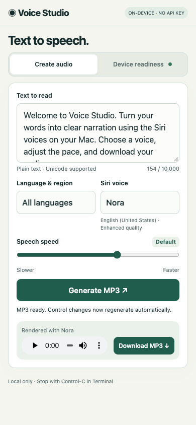
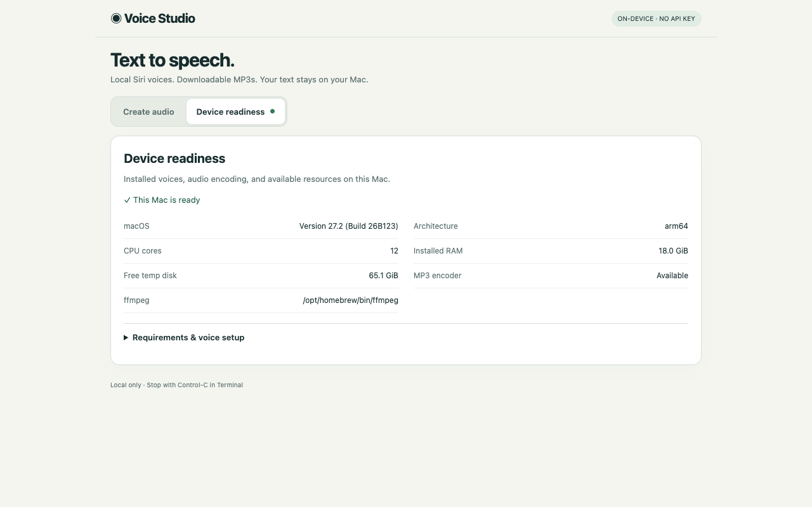

# Voice Studio

Install the current version on macOS from a checkout:

```sh
git clone https://github.com/PrajeetShrestha/voice-cli.git
cd voice-cli
./install.sh --local
```

Already have a checkout? Run `git pull --ff-only` there, then `./install.sh --local`.
Start the Web UI from **any directory**:

```sh
voice-studio web
# Also supported:
voice-studio run web
voice-studio web --no-open
voice-studio --help
```

The browser opens automatically. Keep Terminal running; Control-C stops the server.
If your shell cannot find `voice-studio`, add `export PATH="$HOME/.local/bin:$PATH"`
to your shell profile, then open a new terminal. No project-directory change is
needed after installation. Running `voice-studio` without arguments still works.

Voice Studio turns text into downloadable MP3 narration using the natural Siri voices installed on your Mac. It runs locally with a compact browser interface and an HTTP API for coding agents. No account or API key required.

## Requirements and installation

- **macOS 13+** and **Swift 5.9+**, provided by Xcode or Apple Command Line Tools. If needed, run `xcode-select --install` and finish setup before installing.
- An installed **natural Siri voice**. Download one in System Settings → Siri or Apple Intelligence & Siri → Voice.
- **ffmpeg with libmp3lame**. The installer uses an existing ffmpeg or installs it through an existing Homebrew setup. If neither is available, install [Homebrew](https://brew.sh), then run `brew install ffmpeg`.

The local installer copies this checkout and stores the app in `~/.local/share/voice-studio` with a launcher in `~/.local/bin`. If that directory is on your PATH, you can use `voice-studio` directly. Quit the app before rerunning the installer to reinstall it.

## Using the Web UI

Leave Terminal running while using the app. Your default browser opens automatically; add `--no-open` to the launch command to open the complete URL printed in Terminal manually instead. Each restart creates a new private session URL.

1. Enter text in **Create audio** and choose a language, Siri voice, and speech speed. Nora is selected when available.
2. Click **Generate MP3**. Audio plays when ready; press Play if your browser blocks autoplay.
3. Click **Download MP3** to save a recording before changing controls.

After the first successful generation, changing language, voice, or speed automatically regenerates and plays the latest selection. Editing text alone requires clicking Generate MP3 or changing a voice control.

Open **Device readiness** to inspect missing requirements. Press **Control-C** in Terminal to stop the app and delete temporary audio; saved downloads remain available.

## Narrated demo

[](https://www.youtube.com/watch?v=ZE_4kn-xiFc)

The walkthrough covers installation, the Web UI, and Codex/Claude workflows, narrated by Nora using Voice Studio itself. It includes selectable captions. See the [transcript and rebuild instructions](docs/DEMO.md).

## Web UI screenshots

### Desktop



### Mobile layout



### Device readiness



## Limits and privacy

Text is plain Unicode, up to 10,000 characters, with a 64 KiB request-body limit; some Unicode input reaches a limit earlier. One render runs at a time. At least 256 MiB of free temporary disk space is required, and long passages may need more.

The server accepts connections only from the same Mac at `127.0.0.1`; the mobile layout does not allow a separate phone to connect. Keep the session URL private. There are no external UI assets or analytics. Closing the browser does not stop rendering, and forced termination can leave temporary audio behind.

## Guides and agent workflows

- [Complete usage guide](docs/USAGE.md): voice selection, speech speed, downloads, troubleshooting, and API examples.
- [Agent usage](docs/AGENT_USAGE.md): Python narration helper and copyable prompts for Codex, Claude, or other agents with shell access on the same Mac.
- [Architecture](docs/ARCHITECTURE.md): HTTP server, synthesis pipeline, concurrency, and security boundaries.

## Run from source

Download and extract the [release source archive](https://github.com/PrajeetShrestha/voice-cli/archive/refs/tags/v0.1.0.zip), then run `./run.sh` inside it. Alternatively:

```sh
git clone https://github.com/PrajeetShrestha/voice-cli.git
cd voice-cli
./run.sh
```

The source launcher is intentional: unsigned compiled binaries may not expose the same natural Siri voices. For build commands and integration tests, see [development checks](docs/USAGE.md#building-and-development-checks).

## Uninstall

Stop the app, then remove its installation:

```sh
rm -f ~/.local/bin/voice-studio
rm -rf ~/.local/share/voice-studio
```

This leaves ffmpeg, Homebrew, voice assets, and saved recordings in place.

## Optional Kokoro engine (macOS and Linux)

The latest source checkout supports **Siri + Kokoro on macOS** and **Kokoro on Linux**.
The tagged `v0.1.0` installer is the older Siri-only release; use the current
checkout and `./install.sh --local` for these additions. The current `install.sh` remains a macOS installer.
Linux uses Python directly and does not require Swift.

Kokoro is optional: launching the app never installs Python packages or downloads a
model. The UI shows **Kokoro — not installed** with setup instructions when it cannot
find the packages. On macOS, detection checks `VOICE_STUDIO_KOKORO_PYTHON`, project
`.venv` / `.venv-kokoro`, then common Python paths. Set the variable for installations
elsewhere. An explicit override takes precedence and is not silently replaced.

Use a separate Python **3.10+** environment containing `kokoro`, `torch` and
`soundfile`. Follow the [official Kokoro setup](https://github.com/hexgrad/kokoro)
for language dependencies (including eSpeak-ng where required). Keep model/cache
paths in your existing `HF_HOME` / `XDG_CACHE_HOME` if you already have them.

```sh
export VOICE_STUDIO_KOKORO_PYTHON=/absolute/path/to/kokoro-venv/bin/python
./run.sh
# Headless Linux:
./run.sh --no-open
```

Choose **Kokoro** in the UI, then language/accent, female/male voice and speed
(0.5–2.0×). The catalog contains 54 preset voices, including all nine American male
voices. It is a catalog, not a guarantee that every language dependency is installed.
Package detection is lightweight; the model is loaded and checked on generation.
This adapter uses CPU inference with up to four threads and loads a new process per
render, so generation includes model-loading time.

**Allow missing model, voice and language asset downloads** is off by default.
With it off, cached/offline generation is used and missing assets produce an error.
Enable it deliberately for first use if you want the official model/voice assets
(and required English language model) downloaded. No text is sent to a speech API.
Other languages may require manually installing optional packages. MP3 generation
still requires ffmpeg with libmp3lame. No model installation, cloning, voice training,
or pitch/emotion controls are implied by this integration.

The Python server preserves loopback-only binding, bearer-token authentication,
Host/Origin validation, one active render, bounded requests, timeouts and temporary
outputs. It is not a public server. Do not bind it publicly or share session tokens.

### Kokoro API and command-line generation

`GET /api/status` now includes `engines`; the old `voices` array remains Siri-only
for compatibility. POST `/api/generate` accepts:

```json
{"engine":"kokoro","text":"Hello from Voice Studio.","voice":"am_michael","rate":1.0,"allowDownloads":false}
```

Omitting `engine` on macOS preserves the original Siri API. On Linux, Kokoro is the
only engine. The narration helper supports explicit selection:

```sh
printf 'Hello from Voice Studio.' | python3 scripts/narrate.py \
  --engine kokoro --voice am_michael --rate 1 --output narration.mp3
```

Run `python3 Tests/kokoro.py` for portable catalog, validation and HTTP-security
checks. `python3 Tests/smoke.py` still exercises real Siri generation on macOS.
