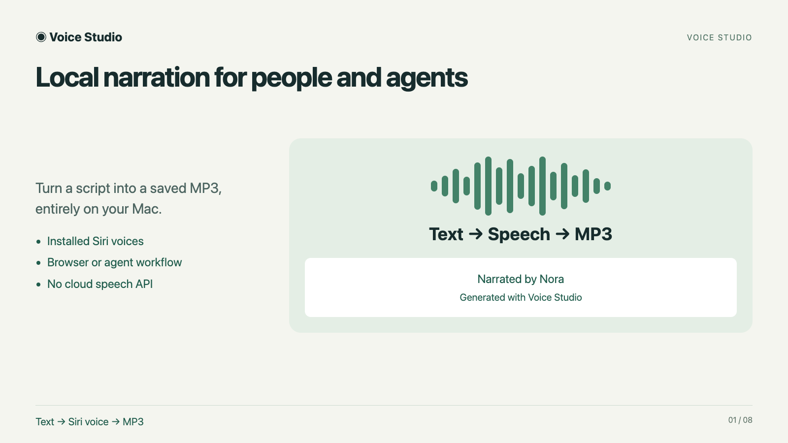

# Voice Studio

```sh
curl -fsSL https://raw.githubusercontent.com/PrajeetShrestha/voice-cli/v0.1.0/install.sh | /bin/sh
```

Start the Web UI:

```sh
~/.local/bin/voice-studio
```

Voice Studio turns text into downloadable MP3 narration using the natural Siri voices installed on your Mac. It runs locally with a compact browser interface and an HTTP API for coding agents. No account or API key required.

## Requirements and installation

- **macOS 13+** and **Swift 5.9+**, provided by Xcode or Apple Command Line Tools. If needed, run `xcode-select --install` and finish setup before installing.
- An installed **natural Siri voice**. Download one in System Settings → Siri or Apple Intelligence & Siri → Voice.
- **ffmpeg with libmp3lame**. The installer uses an existing ffmpeg or installs it through an existing Homebrew setup. If neither is available, install [Homebrew](https://brew.sh), then run `brew install ffmpeg`.

The command above runs [install.sh](install.sh), downloads release `v0.1.0`, and stores the app in `~/.local/share/voice-studio` with a launcher in `~/.local/bin`. If that directory is on your PATH, you can use `voice-studio` directly. Quit the app before rerunning the installer to reinstall it.

## Using the Web UI

Leave Terminal running while using the app. Your default browser opens automatically; add `--no-open` to the launch command to open the complete URL printed in Terminal manually instead. Each restart creates a new private session URL.

1. Enter text in **Create audio** and choose a language, Siri voice, and speech speed. Nora is selected when available.
2. Click **Generate MP3**. Audio plays when ready; press Play if your browser blocks autoplay.
3. Click **Download MP3** to save a recording before changing controls.

After the first successful generation, changing language, voice, or speed automatically regenerates and plays the latest selection. Editing text alone requires clicking Generate MP3 or changing a voice control.

Open **Device readiness** to inspect missing requirements. Press **Control-C** in Terminal to stop the app and delete temporary audio; saved downloads remain available.

## Narrated demo

[](https://github.com/PrajeetShrestha/voice-cli/releases/download/v0.1.0/voice-studio-demo.mp4)

The walkthrough covers installation, the Web UI, and Codex/Claude workflows, narrated by Nora using Voice Studio itself. It includes selectable captions. See the [transcript and rebuild instructions](docs/DEMO.md).

## Web UI screenshots

### Desktop


### Mobile layout


### Device readiness


## Limits and privacy

Text is plain Unicode, up to 10,000 characters, with a 64 KiB request-body limit; some Unicode input reaches a limit earlier. One render runs at a time. At least 256 MiB of free temporary disk space is required, and long passages may need more.

The server accepts connections only from the same Mac at `127.0.0.1`; the mobile layout does not allow a separate phone to connect. Keep the session URL private. There are no external UI assets or analytics. Closing the browser does not stop rendering, and forced termination can leave temporary audio behind.

## Guides and agent workflows

- [Complete usage guide](docs/USAGE.md): voice selection, speech speed, downloads, troubleshooting, and API examples.
- [Agent usage](docs/AGENT_USAGE.md): Python narration helper and copyable prompts for Codex, Claude, or other agents with shell access on the same Mac.
- [Architecture](docs/ARCHITECTURE.md): HTTP server, synthesis pipeline, concurrency, and security boundaries.

## Run from source

Download and extract the [release source archive](https://github.com/PrajeetShrestha/voice-cli/archive/refs/tags/v0.1.0.zip), then run `./run.sh` inside it. Alternatively:

```sh
git clone https://github.com/PrajeetShrestha/voice-cli.git
cd voice-cli
./run.sh
```

The source launcher is intentional: unsigned compiled binaries may not expose the same natural Siri voices. For build commands and integration tests, see [development checks](docs/USAGE.md#building-and-development-checks).

## Uninstall

Stop the app, then remove its installation:

```sh
rm -f ~/.local/bin/voice-studio
rm -rf ~/.local/share/voice-studio
```

This leaves ffmpeg, Homebrew, voice assets, and saved recordings in place.
