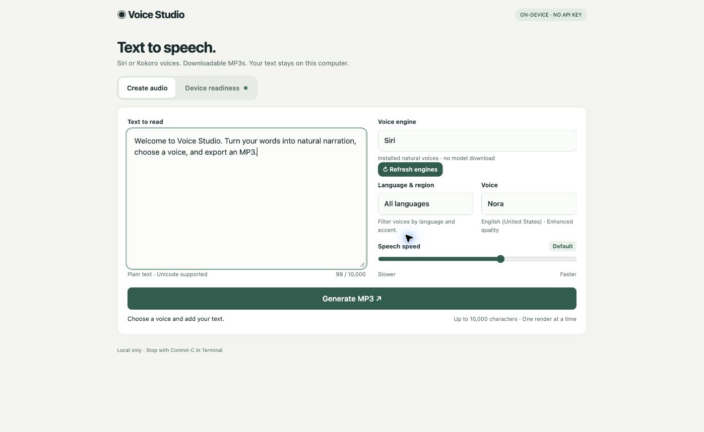
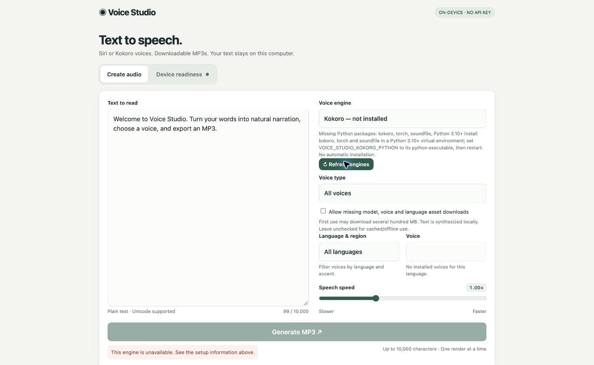

# Voice Studio

Local voiceover on **macOS and Linux**, with a browser UI, MP3 export, and a
loopback-only HTTP API. macOS supports installed Siri voices and optional Kokoro;
Linux uses Kokoro. No account or speech API key is required.

## Install with Homebrew (macOS or Linux)

With [Homebrew](https://brew.sh) installed:

```sh
brew install PrajeetShrestha/tap/voice-studio
voice-studio web
```

This is our [project tap](https://github.com/PrajeetShrestha/homebrew-tap), not a
Homebrew/core package. The formula installs ffmpeg and Python 3.12 dependencies.
On macOS 13+, Apple Command Line Tools with Swift 5.9+ are also needed for Siri
(`xcode-select --install`). Linux does not need Swift. See Homebrew's
[supported Linux environments](https://docs.brew.sh/Homebrew-on-Linux).

```sh
voice-studio run web       # Alias
voice-studio web --no-open # Headless: print the private session URL
voice-studio --help
voice-studio --version
brew upgrade voice-studio
```

Keep Terminal running; Control-C stops the server. No project directory is needed.
Homebrew must be on your PATH (follow `brew shellenv` instructions from its installer).
If an older `~/.local/bin/voice-studio` takes precedence, check `type -a voice-studio`
and use `"$(brew --prefix)/bin/voice-studio" web` or put Homebrew's bin earlier in PATH.
Do not delete a launcher unless you know which installation it belongs to.

**Kokoro is not bundled.** Installing the CLI opens the UI but Linux cannot synthesize
until Kokoro is set up. Install packages in a user-owned environment (outside the
Homebrew Cellar, so upgrades preserve it):

```sh
"$(brew --prefix python@3.12)/bin/python3.12" -m venv "$HOME/.local/share/voice-studio-kokoro"
"$HOME/.local/share/voice-studio-kokoro/bin/python" -m pip install --upgrade pip
# Linux: use CPU-only PyTorch to avoid unnecessary CUDA downloads.
"$HOME/.local/share/voice-studio-kokoro/bin/python" -m pip install torch --index-url https://download.pytorch.org/whl/cpu
"$HOME/.local/share/voice-studio-kokoro/bin/python" -m pip install kokoro soundfile
```

On **macOS**, replace the CPU-index PyTorch command with `python -m pip install torch`
using the same virtual-environment Python path. For language support where needed,
`brew install espeak-ng`; consult [Kokoro's official instructions](https://github.com/hexgrad/kokoro).
The launcher automatically detects the environment above; custom environments can
be selected with `VOICE_STUDIO_KOKORO_PYTHON=/absolute/path/to/python voice-studio web`.
Model and voice files download only when you allow downloads in the UI. They remain
in your user cache, not in the Homebrew installation. The first generation needs
network access; subsequent fully cached generation can run offline.

## Alternative: source / shell installer

For macOS or Linux without a tap install:

```sh
git clone https://github.com/PrajeetShrestha/voice-cli.git
cd voice-cli
./install.sh --local
```

Install the versioned release without retaining a checkout:

```sh
curl -fsSL https://raw.githubusercontent.com/PrajeetShrestha/voice-cli/v0.2.0/install.sh | sh
```

Review remote scripts before executing them. The shell installer requires ffmpeg
and, on Linux, Python 3.10+; it can use an existing Homebrew to install ffmpeg.
It installs into `~/.local/share/voice-studio` and `~/.local/bin`; add that bin
directory to PATH if needed. This is separate from a Homebrew-managed installation.

## Current interface

Real screenshots from the current CLI running in Chrome on macOS. This Mac has
Siri voices installed; Kokoro is **not installed on this Mac**. The second screen
shows the actual setup and refresh state, not a simulated successful installation.





When Kokoro is available, the engine picker enables its 54-voice catalog, voice-type
and language filters, and 0.5–2.0× speed. Real offline Kokoro MP3 generation has been
tested on Linux; a post-install Linux screenshot is not included here.

## Requirements and installation

- **macOS:** macOS 13+ and **Swift 5.9+**, provided by Xcode or Apple Command Line Tools. If needed, run `xcode-select --install` and finish setup before installing.
- **Linux:** Python 3.10+ and Kokoro for narration; no Swift or Siri support.
- For Siri on macOS, an installed **natural Siri voice**. Download one in System Settings → Siri or Apple Intelligence & Siri → Voice.
- **ffmpeg with libmp3lame**. The installer uses an existing ffmpeg or installs it through an existing Homebrew setup. If neither is available, install [Homebrew](https://brew.sh), then run `brew install ffmpeg`.

The local installer copies this checkout and stores the app in `~/.local/share/voice-studio` with a launcher in `~/.local/bin`. If that directory is on your PATH, you can use `voice-studio` directly. Quit the app before rerunning the installer to reinstall it.

## Using the Web UI

Leave Terminal running while using the app. Your default browser opens automatically; add `--no-open` to the launch command to open the complete URL printed in Terminal manually instead. Each restart creates a new private session URL.

1. Enter text in **Create audio** and choose a language, Siri voice, and speech speed. Nora is selected when available.
2. Select **Siri** or **Kokoro**. For Kokoro, filter by voice type and language, choose a voice, and set speed (0.5–2.0×). Allow downloads only if you want missing model/voice assets downloaded.
3. Click **Generate MP3**. Audio plays when ready; press Play if your browser blocks autoplay.
4. Click **Download MP3** to save a recording before changing controls.

After the first successful generation, changing language, voice, or speed automatically regenerates and plays the latest selection. Editing text alone requires clicking Generate MP3 or changing a voice control.

Open **Device readiness** to inspect missing requirements. Press **Control-C** in Terminal to stop the app and delete temporary audio; saved downloads remain available.

## Narrated demo

[](https://www.youtube.com/watch?v=ZE_4kn-xiFc)

The walkthrough covers installation, the Web UI, and Codex/Claude workflows, narrated by Nora using Voice Studio itself. It includes selectable captions. See the [transcript and rebuild instructions](docs/DEMO.md).

## Web UI screenshots

### Desktop


### Mobile layout


### Device readiness


## Limits and privacy

Text is plain Unicode, up to 10,000 characters, with a 64 KiB request-body limit; some Unicode input reaches a limit earlier. One render runs at a time. At least 256 MiB of free temporary disk space is required, and long passages may need more.

The server accepts connections only from the same computer at `127.0.0.1`; the mobile layout does not allow a separate phone to connect. Keep the session URL private. There are no external UI assets or analytics. Closing the browser does not stop rendering, and forced termination can leave temporary audio behind.

## Guides and agent workflows

- [Complete usage guide](docs/USAGE.md): voice selection, speech speed, downloads, troubleshooting, and API examples.
- [Agent usage](docs/AGENT_USAGE.md): Python narration helper and copyable prompts for Codex, Claude, or other agents with shell access on the same Mac.
- [Architecture](docs/ARCHITECTURE.md): HTTP server, synthesis pipeline, concurrency, and security boundaries.

## Run from source

Download and extract the [release source archive](https://github.com/PrajeetShrestha/voice-cli/archive/refs/tags/v0.1.0.zip), then run `./run.sh` inside it. Alternatively:

```sh
git clone https://github.com/PrajeetShrestha/voice-cli.git
cd voice-cli
./run.sh
```

The source launcher is intentional: unsigned compiled binaries may not expose the same natural Siri voices. For build commands and integration tests, see [development checks](docs/USAGE.md#building-and-development-checks).

## Uninstall

Stop the app, then remove its installation:

```sh
rm -f ~/.local/bin/voice-studio
rm -rf ~/.local/share/voice-studio
```

This leaves ffmpeg, Homebrew, voice assets, and saved recordings in place.

## Optional Kokoro engine (macOS and Linux)

The latest source checkout supports **Siri + Kokoro on macOS** and **Kokoro on Linux**.
The tagged `v0.1.0` installer is the older Siri-only release; use the current
checkout and `./install.sh --local` for these additions. The current `install.sh` remains a macOS installer.
Linux uses Python directly and does not require Swift.

After installing Kokoro packages into the configured Python environment, click
**Refresh engines** in the Web UI. The server rechecks availability without restarting,
keeps your text and voice controls, and enables Kokoro when the packages are found.
Refreshing the page also rechecks. If you change the Python environment path itself,
restart with `VOICE_STUDIO_KOKORO_PYTHON=/path/to/python voice-studio web` because a
running process cannot inherit new shell environment variables. Detection confirms
packages, not downloaded model or language assets; these are checked on generation.

Kokoro is optional: launching the app never installs Python packages or downloads a
model. The UI shows **Kokoro — not installed** with setup instructions when it cannot
find the packages. On macOS, detection checks `VOICE_STUDIO_KOKORO_PYTHON`, project
`.venv` / `.venv-kokoro`, then common Python paths. Set the variable for installations
elsewhere. An explicit override takes precedence and is not silently replaced.

Use a separate Python **3.10+** environment containing `kokoro`, `torch` and
`soundfile`. Follow the [official Kokoro setup](https://github.com/hexgrad/kokoro)
for language dependencies (including eSpeak-ng where required). Keep model/cache
paths in your existing `HF_HOME` / `XDG_CACHE_HOME` if you already have them.

```sh
export VOICE_STUDIO_KOKORO_PYTHON=/absolute/path/to/kokoro-venv/bin/python
./run.sh
# Headless Linux:
./run.sh --no-open
```

Choose **Kokoro** in the UI, then language/accent, female/male voice and speed
(0.5–2.0×). The catalog contains 54 preset voices, including all nine American male
voices. It is a catalog, not a guarantee that every language dependency is installed.
Package detection is lightweight; the model is loaded and checked on generation.
This adapter uses CPU inference with up to four threads and loads a new process per
render, so generation includes model-loading time.

**Allow missing model, voice and language asset downloads** is off by default.
With it off, cached/offline generation is used and missing assets produce an error.
Enable it deliberately for first use if you want the official model/voice assets
(and required English language model) downloaded. No text is sent to a speech API.
Other languages may require manually installing optional packages. MP3 generation
still requires ffmpeg with libmp3lame. No model installation, cloning, voice training,
or pitch/emotion controls are implied by this integration.

The Python server preserves loopback-only binding, bearer-token authentication,
Host/Origin validation, one active render, bounded requests, timeouts and temporary
outputs. It is not a public server. Do not bind it publicly or share session tokens.

### Kokoro API and command-line generation

`GET /api/status` now includes `engines`; the old `voices` array remains Siri-only
for compatibility. POST `/api/generate` accepts:

```json
{"engine":"kokoro","text":"Hello from Voice Studio.","voice":"am_michael","rate":1.0,"allowDownloads":false}
```

Omitting `engine` on macOS preserves the original Siri API. On Linux, Kokoro is the
only engine. The narration helper supports explicit selection:

```sh
printf 'Hello from Voice Studio.' | python3 scripts/narrate.py \
  --engine kokoro --voice am_michael --rate 1 --output narration.mp3
```

Run `python3 Tests/kokoro.py` for portable catalog, validation and HTTP-security
checks. `python3 Tests/smoke.py` still exercises real Siri generation on macOS.
